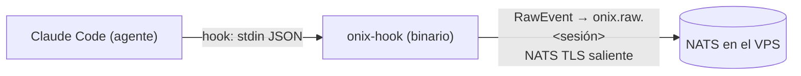

# onix-hook

Binario **Go** que corre **en tu PC**. Lo ejecutan los hooks de Claude Code: arma el evento crudo y lo publica en `onix.raw.<sesión>` por una **conexión saliente** a NATS (TLS) en el VPS. Sin lógica pesada; no bloquea al agente.

> **Estado:** se construye en **Fase 1** (es la pieza que dispara el vertical mínimo E2E). Este README documenta su diseño.

---

## Por qué existe y dónde corre

Es el **único componente que corre en tu casa**, no en el VPS. Así la telemetría sale de tu PC sin abrir puertos: solo hace conexiones **salientes**.



## Cómo funcionará

- Se cablea en `.claude/settings.json` de cada agente para los hooks: `SessionStart`, `PreToolUse`, `PostToolUse`, `Stop`, `SubagentStop`, `Notification`.
- Recibe el payload del hook por **stdin**, lo transforma en un **RawEvent** (ver `onix-contracts`) y lo publica en NATS.
- **Identificación del agente:** lee `ONIX_AGENT_ROLE` y `ONIX_PROJECT` del entorno; si faltan, infiere el rol de la skill activa.
- **No bloquea:** publica y sale rápido; si NATS no responde, falla en silencio para no frenar al agente.
- Config por entorno: `NATS_URL` (TLS, saliente al VPS), `NATS_TOKEN` (token de máquina), `ONIX_AGENT_ROLE`, `ONIX_PROJECT`.

## Contratos

- **Produce:** `RawEvent` en `onix.raw.<claude_session_id>` → lo consume `onix-ingestor`.
- **Importa:** `github.com/levapo97-cell/onix-contracts/go/onixcontracts`.

## Instalación (futuro, Fase 1)

```bash
go build -o onix-hook ./cmd/onix-hook
# instalar en el PATH y referenciar desde los hooks de Claude Code
```

---

*Parte de OnixGuard. Ver el plan en `OnixGuard/docs/PLAN.md` §1 (componentes) y §5 (hooks).*
